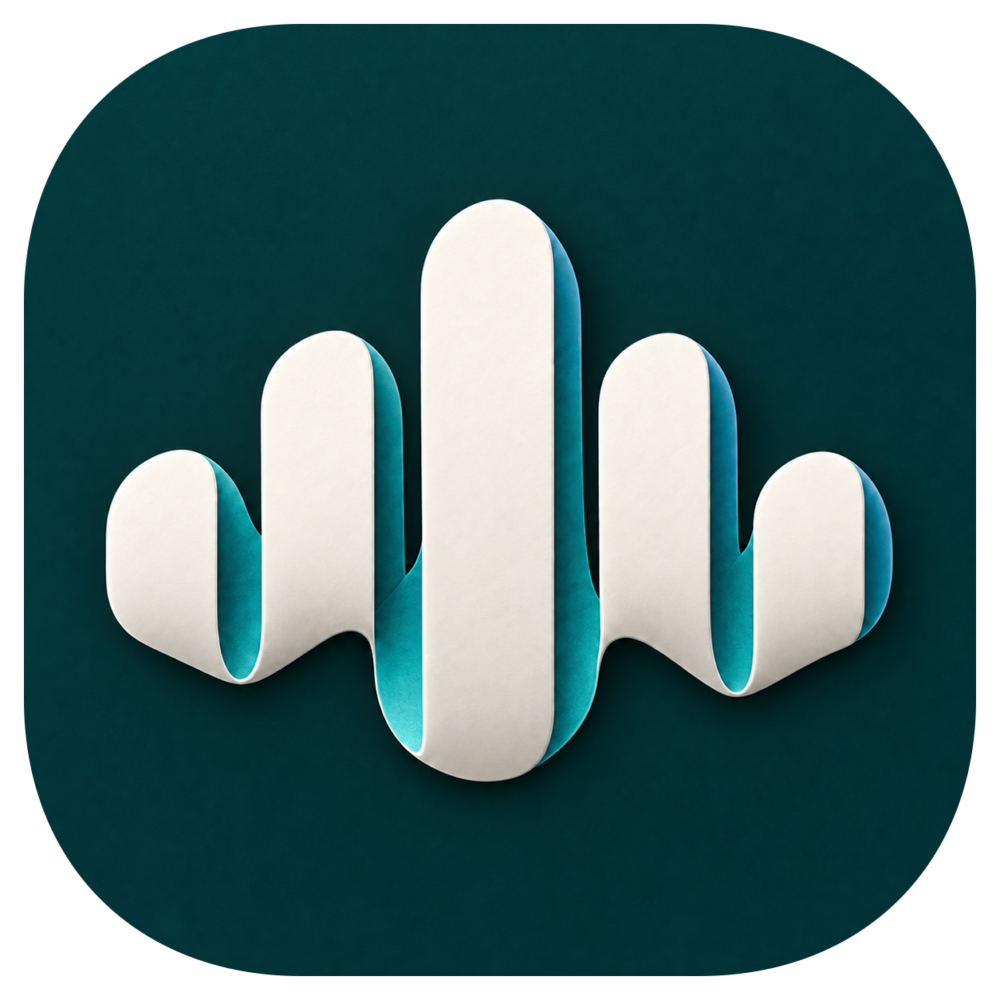
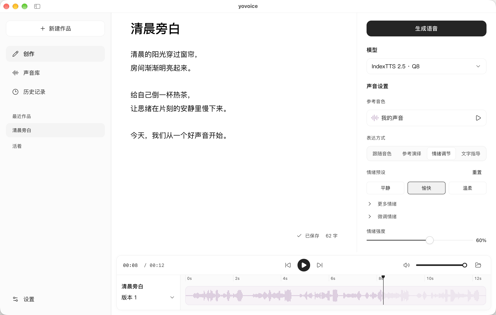

<p align="center">
  
</p>

<h1 align="center">yovoice</h1>
<p align="center">Give your words a voice. Compose your ideas into songs.</p>
<p align="center">
  <a href="https://yovoice.leemysw.com"></a>
  <a href="https://github.com/leemysw/yovoice/releases/latest"></a>
  <a href="https://github.com/leemysw/yovoice/releases"></a>
  <a href="https://github.com/leemysw/yovoice/actions/workflows/check.yml"></a>
  <a href="LICENSE"></a>
  <a href="https://glama.ai/mcp/servers/leemysw/yovoice"></a>
  <a href="https://mcpservers.org/servers/leemysw/yovoice"></a>
  
  
  
</p>
<p align="center">
  <a href="https://www.producthunt.com/products/yovoice?embed=true&amp;utm_source=badge-featured&amp;utm_medium=badge&amp;utm_campaign=badge-yovoice" target="_blank" rel="noopener noreferrer">
    
  </a>
</p>
<p align="center">
  <a href="https://www.star-history.com/leemysw/yovoice">
    <picture>
      <source media="(prefers-color-scheme: dark)" srcset="https://api.star-history.com/badge?repo=leemysw/yovoice&type=rank&theme=dark" />
      <source media="(prefers-color-scheme: light)" srcset="https://api.star-history.com/badge?repo=leemysw/yovoice&type=rank" />
      
    </picture>
  </a>
  <a href="https://trendshift.io/repositories/239687?utm_source=trendshift-badge&amp;utm_medium=badge&amp;utm_campaign=badge-trendshift-239687" target="_blank" rel="noopener noreferrer">
    
  </a>
</p>
<p align="center">English · <a href="README_zh.md">简体中文</a></p>

<p align="center"><a href="https://yovoice.leemysw.com">Website</a> · <a href="docs/cli.md">CLI & Agent Skill</a> · <a href="docs/api.md">API / MCP Deployment</a> · <a href="docs/development.md">Development</a></p>

---

yovoice is an open-source, local-first audio and music creation studio for macOS, Windows and Linux. 

Turn text into expressive speech, natural cloned voices, complete vocal songs, and multi-track scores right on your machine. Featuring zero-shot voice cloning, emotional performance controls, AI music generation with lyrics, and General MIDI score arranging—**all running 100% locally with zero cloud API calls, zero per-character fees, and zero Python environment headaches.**



---

## Why yovoice?

- 🔒 **100% Local Privacy**: Runs entirely on your local GPU/CPU. Your manuscripts, reference voices, and creations never leave your computer.
- 💸 **Zero Recurring Fees**: Say goodbye to per-character/per-minute meters and expensive cloud voice/music subscriptions.
- ⚡ **Native C++ Performance (No Python Hell)**: Powered by [audio.cpp](https://github.com/0xShug0/audio.cpp) v0.9.3. Ships with bundled Windows CUDA 12.4/13.3 runtimes and native macOS Metal support. Double-click and create—no Conda or PyTorch conflicts.
- 🎛️ **Creator Workstation**: Multi-take versioning for side-by-side comparison, waveform trimming, timeline scrolling, and clean stems/MIDI export.
- 🤖 **MCP & AI Agent Ecosystem**: Chat with DeepSeek, Qwen, Claude, OpenAI, or local Ollama to create and edit works end to end. Includes a native Model Context Protocol (MCP) server for Cursor and Claude Code.

---

## Features

- **Speech, voice design and cloning** — clone a reference voice, design a voice from a description, adjust emotion and delivery, and edit takes on a timeline.
- **Story dubbing** — import text or subtitle files, assign a character to each line, and generate line by line.
- **Music** — write a style and lyrics with section markers, then generate songs or instrumentals with ACE-Step 1.5, or songs and score-based instrumentals with YuE2, or instrumental music and sound effects from an English description with Stable Audio 3; the playback page syncs lyrics to the vocals.
- **Score** — write parts by bar and beat, import MIDI or let an Agent compose, render with a General MIDI sound font, and export MIDI and stems. See [Score](docs/score.md).
- **Optional AI service** — the built-in assistant panel chats with DeepSeek, Qwen, Kimi, OpenAI, Anthropic, Ollama or any compatible API and acts on your works: it writes arrangements and lyrics, edits text, assigns voices and starts generation; keys stay on this computer. See [AI service](docs/ai.md).
- **12 interface languages** — English, 简体中文, 繁體中文, 日本語, 한국어, Español, Français, Deutsch, Português (Brasil), Русский, Italiano and Tiếng Việt; switch anytime in Settings, no restart needed.

---

## Supported Models

| Use | Models |
| --- | --- |
| Voice cloning and emotion | IndexTTS 2.0 / 2.5, Qwen3-TTS Base |
| Voice design and cloning | VoxCPM2, OmniVoice, Qwen3-TTS VoiceDesign, Breeze TTS 2 |
| Built-in voices | Kokoro-82M, Qwen3-TTS CustomVoice |
| Songs and instrumentals | ACE-Step 1.5 Turbo / XL Turbo, YuE2 3B |
| Instrumentals and sound effects | Stable Audio 3 Small Music / Small SFX / Medium |

All models are downloaded inside the App or with the CLI. See [model selection](docs/models.md) for file sizes, hardware requirements, inputs and examples. OmniVoice, YuE2 and Breeze TTS 2 weights are restricted to non-commercial use; Stable Audio 3 is free below USD 1M annual revenue under the Stability AI Community License.

---

## Installation

Choose the package for your platform from the repository’s [Releases](../../releases) tab or visit the [official website](https://yovoice.leemysw.com).

| Platform | Package | Install |
| --- | --- | --- |
| macOS 14+ · Apple Silicon | `.dmg` | Open the disk image and drag yovoice to Applications |
| Windows 10/11 · x64 | `-setup.exe` | Run the installer, then open yovoice from the Start menu |
| Windows 10/11 · x64 · NVIDIA GPU | `-cuda12.4-setup.exe` | Bundles the CUDA 12.4 runtime; works with older GPUs and drivers and uses the GPU from first launch |
| Windows 10/11 · x64 · NVIDIA GPU | `-cuda13.3-setup.exe` | Bundles the CUDA 13.3 runtime; needs a newer driver, smaller download |
| Linux · x64 (Debian/Ubuntu) | `-linux-x64.deb` | `sudo apt install ./yovoice-<version>-linux-x64.deb`, then open yovoice from the application menu |
| Linux · x64 (other distributions) | `-linux-x64.tar.gz` | Extract and run `./install.sh` to add yovoice to the application menu for the current user |

The Windows installer downloads and installs [WebView2 Runtime](https://developer.microsoft.com/microsoft-edge/webview2/) if needed. Models are downloaded inside the app; uninstalling preserves user data in `~/.yovoice`.

On Linux the app needs WebKitGTK 4.1 (`libwebkit2gtk-4.1-0` on Debian/Ubuntu, `webkit2gtk4.1` on Fedora, `webkit2gtk-4.1` on Arch); the `.deb` installs it automatically. Linux runs on the CPU out of the box, and a Vulkan GPU runtime can be downloaded in Settings → Inference engine. The Linux app doesn't update itself yet; download new versions from Releases.

Check for updates from the app menu on macOS or Windows. Updates are also checked and downloaded in the background; restart to install when ready. Windows updates download only the app (`-update.exe`) and keep the installed runtime; when a release recommends a newer runtime you can upgrade it in Settings → Inference engine.

---

## Quick Start

1. **Set up a model.** Download a model in Settings (e.g. Kokoro-82M for fast narration, or VoxCPM2 for cloning).
2. **Create a project.** Choose Story dubbing, Speech generation, Music, or Score.
3. **Add content.** Enter text, lyrics, or notes, then pick a character and adjust style.
4. **Generate audio.** Select Generate, then preview, compare takes, edit, and export.

---

## CLI & Agent Skill

Give your agent the [yovoice Skill](https://github.com/leemysw/yovoice/tree/main/skills/yovoice) link and ask it to install the Skill and set up the local CLI, engine, and model:

> Install this Skill and set up yovoice for local speech generation: https://github.com/leemysw/yovoice/tree/main/skills/yovoice

Then describe what you want:

> Read narration.txt using voice.wav as the reference voice, with a calm delivery, and save it as narration.wav.

The agent runs the standalone CLI without opening the desktop app. See the [CLI guide](docs/cli.md) for details.

---

Run `yovoice serve` to provide an authenticated HTTP API and MCP inference service for other machines. See the [API / MCP deployment guide](docs/api.md) for deployment and client examples.

<a href="https://glama.ai/mcp/servers/leemysw/yovoice"></a>

## Development

```sh
make install
make app-run
```

See the [development guide](docs/development.md) for prerequisites. It also covers browser preview, tests, and project structure. For how the processes and packages fit together, see [Architecture](docs/architecture.md).

---

## Community

Scan the QR code with WeChat to join the yovoice user group. If the code has expired, open an [issue](../../issues) and we will post a new one.

<p align="center"></p>

---

## Contributing

Bug reports, feature suggestions, and pull requests are welcome. Include your platform, model, and steps to reproduce when reporting a problem. Run `make check` before submitting code changes.

---

## Acknowledgements

- [audio.cpp](https://github.com/0xShug0/audio.cpp) by ShugoAI — the local audio inference engine.
- [VoxCPM](https://github.com/OpenBMB/VoxCPM) — voice design and cloning models, licensed under Apache-2.0.
- [IndexTTS](https://github.com/index-tts/index-tts) — the speech synthesis models behind yovoice.
- [OmniVoice](https://github.com/k2-fsa/OmniVoice) — voice design and cloning models.
- [Qwen3-TTS](https://github.com/QwenLM/Qwen3-TTS) — voice cloning, built-in voices, and text-guided voice design.
- [ACE-Step](https://github.com/ace-step/ACE-Step-1.5) — music generation from style prompts and lyrics.
- [YuE](https://github.com/multimodal-art-projection/YuE) — full vocal song generation from lyrics.
- [Stable Audio 3](https://huggingface.co/stabilityai/stable-audio-3-medium) by Stability AI — instrumental music and sound effects from text. Powered by Stability AI.
- [Breeze TTS 2](https://huggingface.co/BreezeBlue/Breeze-TTS-2) — Chinese and English voice design and cloning.
- [go-meltysynth](https://github.com/sinshu/go-meltysynth), [MuseScore General](https://musescore.org/en/handbook/3/soundfonts-and-sfz-files#gm_soundfonts), [GeneralUser GS](https://www.schristiancollins.com/generaluser) and SGM-V2.01 by David Shan — the SoundFont synthesizer and sound fonts behind score rendering.
- Kokoro — lightweight speech synthesis with built-in voices: [Kokoro-82M](https://huggingface.co/hexgrad/Kokoro-82M) and [Kokoro-82M-v1.1-zh](https://huggingface.co/hexgrad/Kokoro-82M-v1.1-zh).

---

## Star History

<a href="https://www.star-history.com/?repos=leemysw%2Fyovoice&type=date&legend=bottom-right">
 <picture>
   <source media="(prefers-color-scheme: dark)" srcset="https://api.star-history.com/chart?repos=leemysw/yovoice&type=date&theme=dark&legend=bottom-right" />
   <source media="(prefers-color-scheme: light)" srcset="https://api.star-history.com/chart?repos=leemysw/yovoice&type=date&legend=bottom-right" />
   
 </picture>
</a>

---

## License

[Apache-2.0](LICENSE). Dependencies retain their [original licenses](THIRD_PARTY_NOTICES.md); IndexTTS models are covered separately by their [model license](web/public/model-license.txt).
