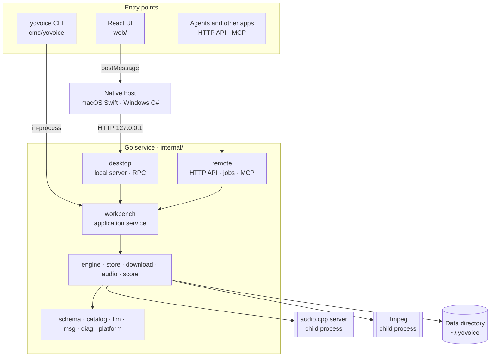
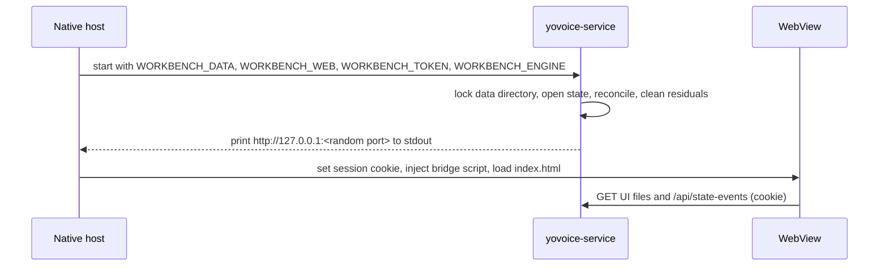
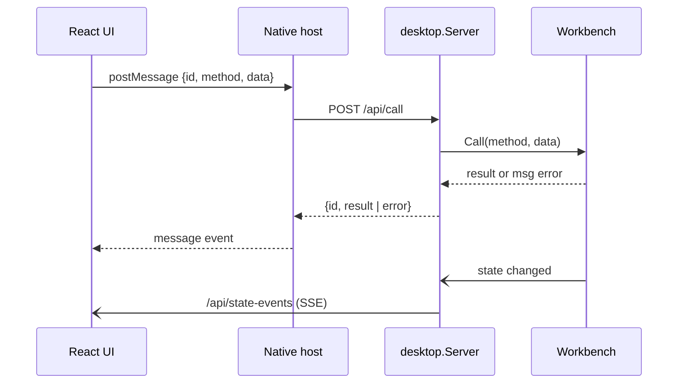

# Architecture

[简体中文](architecture_zh.md)

This page describes how yovoice is put together at runtime: which processes run, how a request travels from the UI to the inference engine, and where data lives. For package responsibilities and coding conventions, see [Development › Architecture conventions](development.md#architecture-conventions).

## Overview

All three entry points share one application layer, `workbench`. The transport packages only decode requests and call public `Workbench` methods, so a feature added to `workbench` is available to the desktop app, the CLI and the API alike.

## Processes

| Process | Binary | Role |
| --- | --- | --- |
| Native host | `VoiceWorkbenchMac` / `VoiceWorkbench.exe` | Window, WebView, file dialogs, app updates; starts and stops the service |
| Local service | `yovoice-service` | Serves the UI files, RPC calls, state events and media on `127.0.0.1` |
| Inference engine | `audiocpp_server` ([audio.cpp](https://github.com/0xShug0/audio.cpp)) | Loads one model and runs speech and music tasks |
| Audio converter | bundled `ffmpeg` | Decodes imported audio and video, encodes exports |
| CLI | `yovoice` | Runs `workbench` in its own process; `yovoice serve` adds the HTTP API and MCP |

Score rendering does not use the engine: `internal/score` renders General MIDI sound fonts in-process with [go-meltysynth](https://github.com/sinshu/go-meltysynth).

### Desktop startup

- The service listens on a random port on `127.0.0.1` and accepts only requests carrying the session cookie and a matching `Origin`.
- `service.lock` in the data directory makes sure only one process opens the state at a time. The CLI uses the same data directory, so it cannot run while the desktop app holds the lock.
- The service exits when its stdin closes, on `SIGTERM`, or after `POST /shutdown`. Before quitting, the host saves the open draft and calls `/shutdown` so that running calls finish cleanly.

## Request flow

### Desktop calls

- The UI calls the backend only through `web/src/shared/lib/client.ts`. On the desktop it goes through `bridge.ts`. In browser preview (`make dev`) a mock backend in `preview-backend.ts` takes its place, so speech generation is not available there.
- On Windows, WebView2 provides `window.chrome.webview` natively. On macOS, the host injects a script with the same API backed by `WKScriptMessageHandler`, so the UI code is identical.
- The host handles some methods itself before forwarding, such as revealing a file in Finder/Explorer, choosing folders and moving the data directory.
- Results return as a reply to the call. Progress and every other state change are pushed as a full `State` snapshot over Server-Sent Events, so the UI never polls.
- Audio plays from `/media/voices/<file>` and `/media/outputs/<file>`.
- Errors are `msg` codes with parameters. The UI turns them into text through the i18n catalogs, which keeps the Go service language-neutral.

### Generation

1. `workbench` validates the draft against `schema` and the model package from `catalog`, then starts a background operation and records it in `State.Activity`.
2. `engine` maps the draft to an audio.cpp request. If no engine is running, or the running one has a different model, backend or load options, it stops the old process and starts `audiocpp_server --config … --no-ui` on a free local port, waiting for `/health`.
3. The request goes to `POST /v1/tasks/run`. Progress updates `State`, which the UI receives as events.
4. The output WAV is written to `outputs/` and a generation record is added to the project's history.

The engine process stays loaded between generations of the same model, which makes later takes faster. A stale process left by a crash is found through `runtime/engine.pid` and killed on the next start.

### Concurrency

- RPC calls run concurrently. Short read-validate-write transactions are serialized by an edit lock inside `Workbench`.
- Long operations run in the background with their own cancel function. Inference, conversion and runtime installs share one slot, while model downloads have a separate one, so you can download a model while another one generates.
- API jobs (`internal/remote`) run through the same `Workbench`, so desktop and API generations never compete for the GPU. While another generation is running, a new API job is rejected as busy instead of being queued; clients retry or poll.

## Other entry points

- **CLI** (`cmd/yovoice`) builds a `Workbench` on the data directory and calls it directly. It suits scripts and Agent skills. See the [CLI guide](cli.md).
- **`yovoice serve`** exposes `internal/remote` over HTTP with a bearer token (optionally TLS) and MCP over HTTP or stdio. See [API / MCP deployment](api.md). The server documents itself with an OpenAPI page at `/docs/`.
- **Local API** can also be turned on inside the desktop app (Settings). It runs the same `remote` handler on `127.0.0.1`, sharing the app's `Workbench`.

## AI service

`internal/llm` sends prompts to the provider configured in Settings: an OpenAI-compatible API, Anthropic, or Ollama, using the presets in `presets.json`. `workbench` uses it for background tasks such as casting imported novels and checks the replies before saving; scores, lyrics and melody scores are written by the built-in assistant (`internal/assistant`), whose tools validate every change. Keys are stored in a private table of the local database that is never broadcast to the UI, and no other part of yovoice talks to the network except model and runtime downloads. See [AI service](ai.md).

## Data directory

The default location is `~/.yovoice`. It can be moved in Settings › Storage, and the chosen path is saved in a small config file under `~/Library/Application Support` (macOS) or `%APPDATA%` (Windows).

| Path | Contents |
| --- | --- |
| `yovoice.db` | SQLite state: projects, voices, history, preferences |
| `yovoice.backup.db` | Backup refreshed on open and every 30 minutes; restored automatically if the main database is corrupt |
| `voices/` | Reference audio for voices |
| `outputs/` | Generated audio |
| `models/` | Installed model packages and sound fonts |
| `runtime/` | Installed audio.cpp runtimes and `engine.pid` |
| `downloads/` | Partial downloads and temporary conversions, cleaned on startup |
| `logs/` | Structured service log `service.log` (viewable and exportable in Settings › Logs), host logs and the raw inference output `engine.log` |
| `host-preferences.json` | UI language for the native host, derived from the database |
| `service.lock` | Held by the running service |

`Store` keeps the current `State` in memory, writes only changed rows in a transaction, and notifies subscribers, which drives the state events above.

## Model catalog

The models the app can install, their files, checksums, generation options and engine settings come from JSON files embedded in the service:

- `internal/catalog/catalog.json`: model packages and their files.
- `internal/catalog/generation_options.json` and `omni_attributes.json`: per-model controls. The UI imports these same files (and `catalog.json`, `internal/llm/presets.json`) through the Vite alias `@internal` instead of keeping copies.
- `internal/catalog/engine.json`: recommended and minimum audio.cpp versions with archive checksums.

Adding a model is therefore mostly data: describe the package in the catalog, map its parameters in `engine/request.go` and expose its options in the UI. The UI imports these files directly through the `@internal` alias, so there is no second copy to keep in sync.
