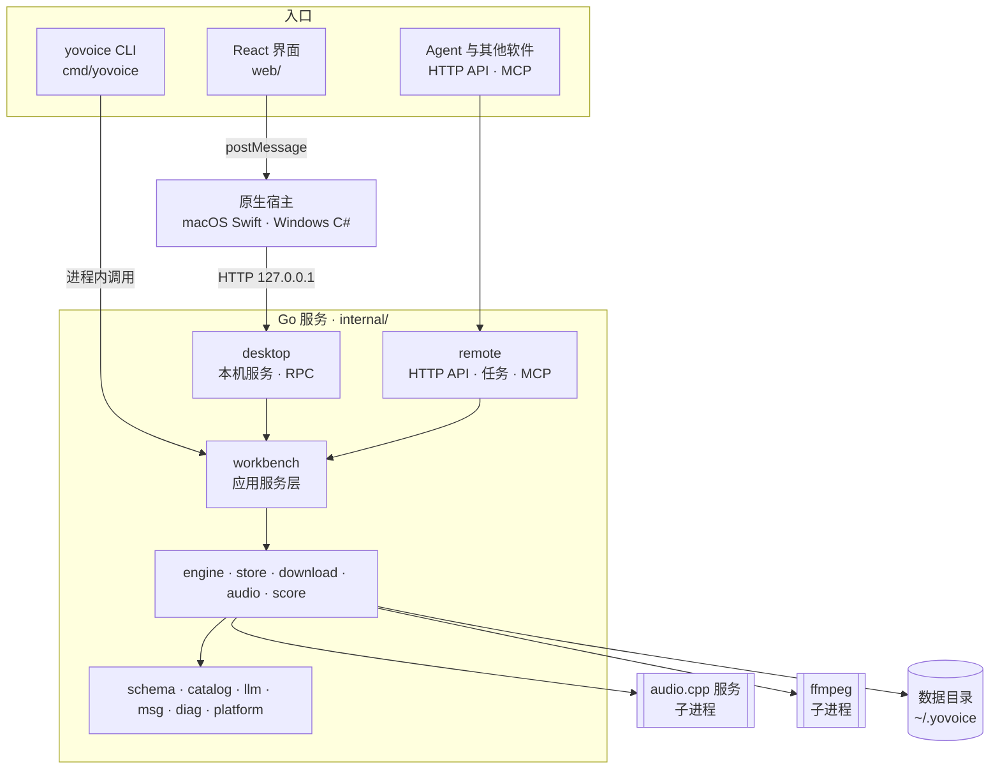
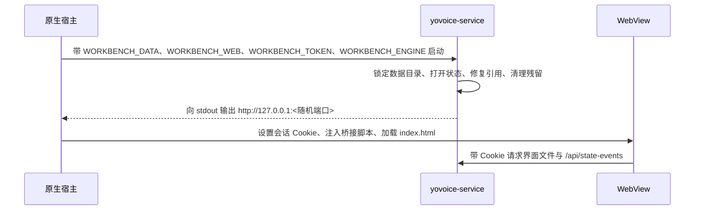
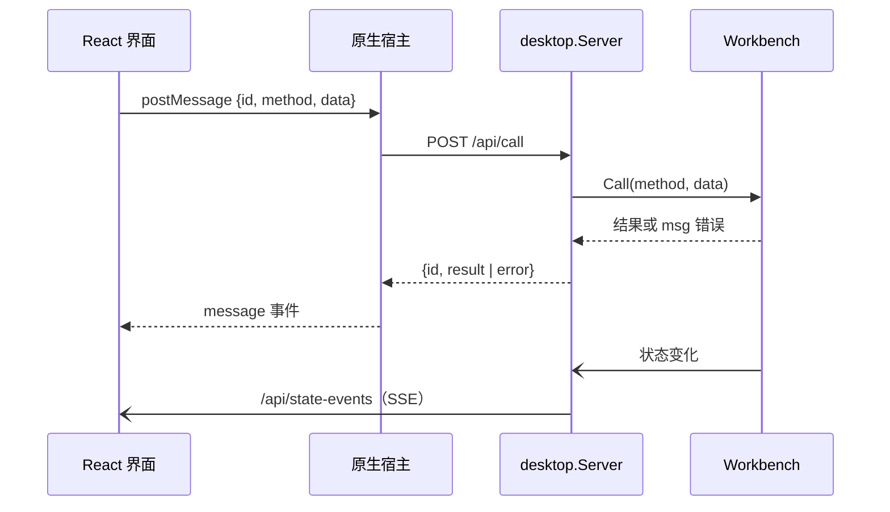

# 架构

[English](architecture.md)

本文介绍 yovoice 运行时的组成：有哪些进程、一次请求如何从界面到达推理引擎、数据保存在哪里。包职责与编码约定见[开发指南 › 架构约定](development_zh.md#架构约定)。

## 总览

三个入口共用同一个应用层 `workbench`。传输层只负责解码请求并调用 `Workbench` 的公开方法，因此在 `workbench` 中新增的功能，桌面应用、CLI 和 API 都能直接使用。

## 进程

| 进程 | 可执行文件 | 职责 |
| --- | --- | --- |
| 原生宿主 | `VoiceWorkbenchMac` / `VoiceWorkbench.exe` | 窗口、WebView、文件对话框、应用更新；启动和停止服务 |
| 本机服务 | `yovoice-service` | 在 `127.0.0.1` 上提供界面文件、RPC、状态事件和媒体文件 |
| 推理引擎 | `audiocpp_server`（[audio.cpp](https://github.com/0xShug0/audio.cpp)） | 加载一个模型，执行语音和音乐任务 |
| 音频转换 | 随附的 `ffmpeg` | 解码导入的音视频，编码导出文件 |
| CLI | `yovoice` | 在自身进程中运行 `workbench`；`yovoice serve` 额外提供 HTTP API 与 MCP |

编曲渲染不经过推理引擎：`internal/score` 在进程内用 [go-meltysynth](https://github.com/sinshu/go-meltysynth) 渲染 General MIDI 音色库。

### 桌面启动

- 服务监听 `127.0.0.1` 的随机端口，只接受携带会话 Cookie 且 `Origin` 匹配的请求。
- 数据目录中的 `service.lock` 保证同一时间只有一个进程打开状态。CLI 使用相同的数据目录，所以桌面应用持有锁时 CLI 无法运行。
- 服务在 stdin 关闭、收到 `SIGTERM` 或 `POST /shutdown` 后退出。退出前宿主会先保存当前草稿再调用 `/shutdown`，让进行中的调用正常结束。

## 请求链路

### 桌面调用

- 界面只通过 `web/src/shared/lib/client.ts` 调用后端：桌面端走 `bridge.ts`；浏览器预览（`make dev`）由 `preview-backend.ts` 的模拟后端代替，因此预览中不能生成语音。
- Windows 上 WebView2 原生提供 `window.chrome.webview`；macOS 宿主注入一段脚本，用 `WKScriptMessageHandler` 实现相同的接口，所以两端的界面代码完全一致。
- 少数方法由宿主先行处理再转发，例如在访达或资源管理器中显示文件、选择目录、迁移数据目录。
- 调用结果作为回复返回；进度和其他状态变化以完整的 `State` 快照通过 Server-Sent Events 推送，界面不需要轮询。
- 音频从 `/media/voices/<文件>` 和 `/media/outputs/<文件>` 播放。
- 错误是带参数的 `msg` 代码，由界面经 i18n 文案转换为文字，Go 服务本身不包含界面语言。

### 生成

1. `workbench` 按 `schema` 和 `catalog` 中的模型包校验草稿，启动后台操作，并记录在 `State.Activity` 中。
2. `engine` 把草稿映射为 audio.cpp 请求。如果引擎未运行，或正在运行的引擎使用的模型、后端或加载参数不同，就停止旧进程，在空闲端口上启动 `audiocpp_server --config … --no-ui`，并等待 `/health` 就绪。
3. 请求发送到 `POST /v1/tasks/run`，进度写入 `State`，界面以事件形式收到。
4. 输出的 WAV 写入 `outputs/`，生成记录加入作品的历史。

同一模型连续生成时引擎进程保持加载，后续生成会更快。崩溃遗留的进程会在下次启动时通过 `runtime/engine.pid` 找到并结束。

### 并发

- RPC 调用并发执行；短的“读取—校验—写入”事务由 `Workbench` 内部的编辑锁串行化。
- 耗时操作在后台运行，并各自带有取消函数。推理、转换和运行时安装共用一个槽位，模型下载使用另一个槽位，所以可以一边生成一边下载其他模型。
- API 任务（`internal/remote`）同样经过 `Workbench`，桌面和 API 的生成不会同时争用 GPU。已有生成在运行时，新的 API 任务会被拒绝并返回“繁忙”，而不是排队；客户端需要重试或轮询。

## 其他入口

- **CLI**（`cmd/yovoice`）在数据目录上创建 `Workbench` 并直接调用，适合脚本和 Agent Skill。见 [CLI 指南](cli_zh.md)。
- **`yovoice serve`** 通过 HTTP 提供 `internal/remote`，使用 Bearer 令牌认证，可选 TLS；MCP 支持 HTTP 和 stdio。见 [API / MCP 部署](api_zh.md)。服务自带 OpenAPI 文档页 `/docs/`。
- **本机接口**也可以在桌面应用的设置中开启。它在 `127.0.0.1` 上运行同一个 `remote` 处理器，与应用共用 `Workbench`。

## AI 服务

`internal/llm` 按设置中选择的服务商发送提示词，支持 OpenAI 兼容接口、Anthropic 和 Ollama，预设见 `presets.json`。`workbench` 用它做导入小说选角等后台任务，回复校验通过后才保存；写谱、写词与改旋律谱由内置创作助手（`internal/assistant`）完成，每次修改都经工具校验。密钥保存在本地数据库的私有表中，不会广播给界面。除模型和运行时下载外，yovoice 的其他部分都不联网。见 [AI 服务](ai_zh.md)。

## 数据目录

默认位置是 `~/.yovoice`，可以在“设置 › 存储”中迁移。选择的路径记录在一个小配置文件中，位于 `~/Library/Application Support`（macOS）或 `%APPDATA%`（Windows）下。

| 路径 | 内容 |
| --- | --- |
| `yovoice.db` | SQLite 状态库：作品、音色、历史、偏好 |
| `yovoice.backup.db` | 每次打开及每 30 分钟刷新的备份；主库损坏时自动恢复 |
| `voices/` | 音色的参考音频 |
| `outputs/` | 生成的音频 |
| `models/` | 已安装的模型包和音色库 |
| `runtime/` | 已安装的 audio.cpp 运行时和 `engine.pid` |
| `downloads/` | 未完成的下载和临时转换文件，启动时清理 |
| `logs/` | 结构化服务日志 `service.log`（可在设置 › 日志中查看和导出诊断包）、宿主日志与推理进程原始输出 `engine.log` |
| `host-preferences.json` | 供原生宿主读取的界面语言，由数据库派生 |
| `service.lock` | 由运行中的服务持有 |

`Store` 在内存中保存当前 `State`，以事务只写入有变化的行，并通知订阅者，这就是上文状态事件的来源。

## 模型目录

可安装的模型、文件、校验和、生成选项和引擎设置都来自内嵌在服务中的 JSON 文件：

- `internal/catalog/catalog.json`：模型包及其文件。
- `internal/catalog/generation_options.json` 与 `omni_attributes.json`：各模型的控件；界面经 Vite 别名 `@internal` 直接引用这些文件（以及 `catalog.json`、`internal/llm/presets.json`），不再保存副本。
- `internal/catalog/engine.json`：推荐和最低的 audio.cpp 版本及压缩包校验和。

因此新增模型主要是改数据：在目录中描述模型包，在 `engine/request.go` 中映射参数，并在界面中提供选项。界面通过 `@internal` 别名直接引用这些文件，不再保留第二份副本。
